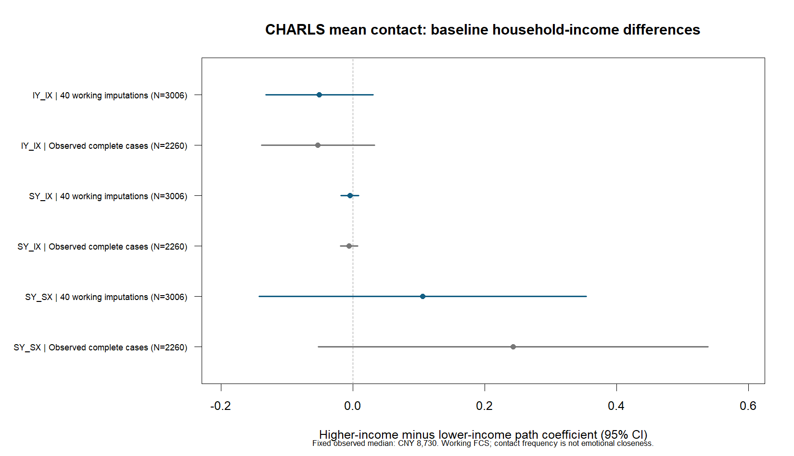

# CHARLS 总体联系频率 H4.1：收入家族与基期缺失处理

**四项调节完整推断、完整 H4 仍未完成。** 本批推进总体联系频率与基期家庭收入组的三条路径差异；保留旧CFPS失败规格、原始数据、原稿和已关闭的范围稿，CFPS新增估计0，新增NLM0。

## 本批状态

收入资源家族40/40份合法，按完整TECH3协方差合并。 本批45次引擎调用，含1次被主机待机中断的调用及其1次恢复；预算计费554.08秒，原始累计墙钟2458.53秒。原中断调用的原始2024.51秒记录未改写，依据Windows睡眠事件只抵扣1904.51秒，仍保守计费120秒。其余新调用同时保存清醒时间和真实墙钟，未将睡眠当成估计失败。

已独立核对3517条高精度参数及6424行MplusAutomation打印参数；完整协方差、组差、标量Rubin与三路径D1均从原始参数保存文件复算。完整案例两起点均合法且一致；其范围为2260人、428社区，仅作敏感性对照。

## 数据、基期控制与缺失处理

完整核心队列3006人、440社区，保留五期X/Y原观测和缺失位置。11项控制依次为年龄、女性、初中及以上、城市、配偶、有效报告子女数、ADL与自评健康四个虚拟变量。年龄沿用70岁中心化后除以10；原始控制列、实际模型输入、行序和社区逐列核验。

家庭净收入缺734人，ADL缺20人，共缺8人。固定观测家庭收入中位数8730元，`G=1(income>8730)`；观测高低各1136人、等于切点0人。51个负值与136个零值原样保留；没有把缺失归低收入，没有按每份插补重选切点。保留队列中3006人对应3006个不同家庭ID，因此本队列不存在同户多人的收入共同值冲突；社区仍作为聚类层。

本批只插补二元收入组G及ADL，不补造缺失的货币金额。社区随机截距工作FCS中，G用已校准的TMB/Laplace二元条件抽样，ADL用5供体预测均值匹配。条件模型包括原控制、观测波次/缺失指示，以及轨迹OLS辅助摘要、平方/交叉和相关控制乘积。OLS摘要仅作插补辅助量，不替代正式潜增长因子。G的87项、ADL的57项预测量及32个被动乘积按实际矩阵核验；同一目标的被动乘积不能反过来预测自身。

40条链分两块各20条，以冻结种子运行10轮；最终合并后G和ADL最后5轮PSRF均有限且<1.1，最大1.03411。全部原观测、被动恒等式、ADL供体支持、40份DAT和X/Y缺失位置通过独立检查。该诊断是本批工作链混合验收，不能证明MAR成立、模型无偏或与潜增长实质模型精确相容。

## 收入组差

| label | estimate | se | lower | upper | p | FMI |
| --- | --- | --- | --- | --- | --- | --- |
| dii | -0.0507008 | 0.0414598 | -0.132004 | 0.0306019 | 0.221497 | 0.13134 |
| dis | -0.00435557 | 0.00682789 | -0.0177522 | 0.00904106 | 0.523661 | 0.186254 |
| dss | 0.106009 | 0.126634 | -0.142355 | 0.354374 | 0.402631 | 0.147831 |

dii、dis、dss依次为IX→IY、IX→SY、SX→SY的高收入减低收入组差。组内系数及组差均采用完整协方差，见GROUP_CONTRASTS.csv；不能用两组显著性不同推定组差显著。名义95%区间与各单路径p值完整呈现，不按显著性筛选。

## 三个总体联系频率资源家族的联合检验

| group | F | df1 | df2 | p | holm_planned3 |
| --- | --- | --- | --- | --- | --- |
| EDU | 0.535801 | 3 | 5.04175e+09 | 0.657713 | 0.657713 |
| URBAN | 2.17524 | 3 | 2.17538e+11 | 0.0886534 | 0.26596 |
| INCOME | 1.44952 | 3 | 4571.38 | 0.226353 | 0.452707 |

三条收入组差的95%区间均包含0；三路径联合D1检验p=0.226353，三个资源家族Holm校正后p=0.452707。当前工作模型未提供明确的收入组差证据；这不证明组差为零，也不代表完整H4已经检验。

EDU、URBAN来自已发布的原20份工作MI家族，INCOME为本批40份工作MI（仅完整合法时列入）。三个家族固定作为这组总体联系频率H4.1联合检验的Holm校正范围，旧两项校正保留为历史，不作整个研究所有探索的错误率控制。三种基期资源的二元定义沿用各自冻结合同，不能跨资料解释为同一资源测量。

## 完整案例敏感性

| contrast | estimate | se | lower | upper | p |
| --- | --- | --- | --- | --- | --- |
| IY_IX_difference | -0.0528018 | 0.0437547 | -0.138559 | 0.0329559 | 0.227522 |
| SY_IX_difference | -0.00581596 | 0.00670489 | -0.0189573 | 0.00732538 | 0.385711 |
| SY_SX_difference | 0.243545 | 0.150832 | -0.0520813 | 0.539171 | 0.106382 |

完整案例与MI样本量和缺失处理不同，差异不能唯一归因于插补。该对照不能替代缺失机制或非随机缺失敏感性检验，也不能用来替换不显著的完整家族。

## 模型与范围

固定五期时间载荷0、2、4、7、9；保持既有同期剩余相关、11控制和社区稳健协方差。收入组的四个增长因子主效应均保留，父模型77参数，三条组差模型80参数。已观测二元G采用已校准的完全已知类别表达，避免不必要的数值积分；非目标约束保持相同。收入原来不是11项控制之一，所以不能直接照搬教育/城乡的参数个数。先验父模型和MI01双起点合法一致，才运行其余成员；没有为通过验收固定负方差或更换插补成员。

CHARLS测量的是联系频率，不是CFPS情感亲近度。本批是已观测资源组的工作MI检验，既不是四类潜在关系结构调节的完整推断，也不补齐CFPS尚未可采用的H4分支。已有CHARLS基期差异H4.1/H4.2各12个工作家族、四项观测基期动态调节各20份均复用，不能与本批新增总体联系频率家族混入同一分母。

## 中断恢复与效率

A块20链10轮已完成并复用。B块因合盖Modern Standby后旧墙钟看门狗误计时中断，从第6轮MIDS、原随机状态及确定性拟合缓存恢复，保留第7轮未完成的原记录。没有换种子挑选成功成员。完整案例B原输出直接复用，只恢复被同次待机中断的A一次。

Windows事件507确认睡眠1962.315秒；新预算时钟使用QueryUnbiasedInterruptTime，对S0长采样空档额外核对明确的睡眠事件并防止双扣。保留原始墙钟及错误记录，模拟33分钟暂停和真正超时的测试均通过；没有改变全局合盖/电源策略。临时保持唤醒请求不能保证覆盖用户合盖。

最终收束另发现本批FULL的保持唤醒辅助程序在导入`mplus_queue`时已退出，未取得电源请求，不能写成“成功释放”。原辅助程序、失败日志和实际未取得请求的记录保留；后续启动器已改为独立依赖、独占目录、取得请求后才放行，并完成一次真实Windows取得/释放及重复目录拒绝检查，未新增Mplus估计。此修复发生在模型完成后，不追溯声称旧批次受该辅助程序保护，也未冒称已包含在先前合并的PR35中。

20链实际R峰值约0.64GiB，高于2链试运行约0.45GiB；后续准入改用已观察最大峰值加原保留余量。RSS缩减没有让Windows可用物理内存等量增加，因此不用于声称释放成功或强行增加并发。其他研究RStudio/Mplus均未接管。

## 交付与复用

公开包只含代码、聚合表、参数/协方差、原始模型输出及运行证据，不含个人DAT/RDS/MIDS。`estimates.dat`和`tech3.dat`为模型参数保存文件。解压后运行`python code/verify_results.py --public`可复算参数变换、Rubin、完整协方差组差及D1，无需Mplus。逐人数据与似然检查只在本机完成。

本批是实证增量报告，不修改正式论文、不追加NLM。模型有可采用估计不等于假设得到支持；完整报告的区间和联合检验决定解释范围。

`mplusautomation-guide` PR35已合并（7a5dcea5b7e90a0540b4499170269a4d1e1fd509），记录待机时钟、同随机状态恢复、mice::ibind完整列NULL槽修复及实际内存峰值准入。本批没有改动本机托管安装；GitHub合并与本机安装状态分别记录。
