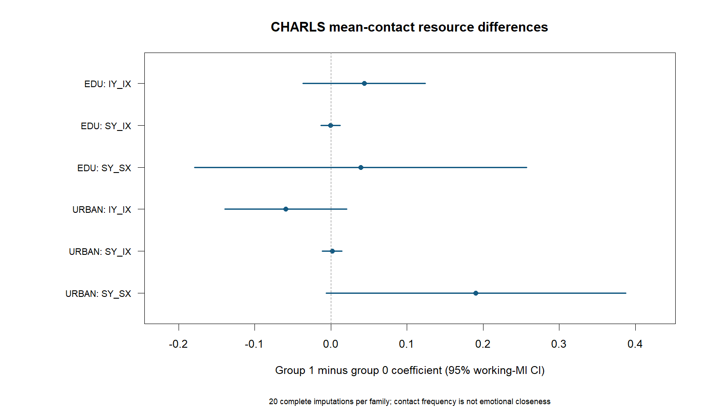

# CHARLS 总体联系频率的 H4.1 教育／城乡完整工作插补家族

**四项调节完整推断、完整 H4 仍未完成。** 本批补上完整核心队列中的总体联系频率与资源交互，不能与先前“四种基期差异指标×三种资源”的12个家族重复计数。本批没有重跑任何失败 CFPS 规格，没有改动原论文或原始数据。

## 本批完成范围

核心队列为3,006人、440个社区，原11项控制、五期观测及缺失位置保留。教育（初中及以上=1）和城乡（城市=1）均为已观测二元变量；ADL有20人缺失。已独立生成20份工作插补，只插补 ADL，保留原观测和全部轨迹缺失位置；独立回读最大导出差异为0。

实际控制入口依次为年龄、女性、初中及以上教育、城市、配偶状态、有效报告子女数、ADL，以及自评健康的四个虚拟变量；年龄按既有模型以70岁为中心并除以10。教育／城乡作为本批组别时，其主效应由等价类别表达的因子截距差承接，并未从调整结构中删除。基期来源、原观测与20份实际输入的控制列均已逐列核对。

每个家族同时估计 IX×G→IY、IX×G→SY、SX×G→SY。已观测二元G用完全已知类别的条件高斯表达计算；仅三条目标路径允许组差，其他非目标参数保持原约束。旧同数据父模型73个参数、标准误、完整协方差与条件似然的等价校准通过；每个新家族先核对两套不同初值，再扩展全部20份。没有固定负方差、丢弃失败成员或按显著性选择模型。

完成家族：2/2。新调用共44次，累计引擎／启动器时间368.37秒；独立读取3338条高精度自由参数和6072条MplusAutomation打印行。一次校准读回误报由十进制缺失标记解析引起，修复读回后复用原输出，未因此重复估计。

城乡MI12曾在提交前因外部Mplus增加至3个而等待。本批前35次自有进程树峰值192.14 MiB，等待时Windows可用物理内存2.26 GiB、commit余量10.48 GiB、CPU62.2%。核验旧协调器已退出、该成员没有输出及预算占用后，保存旧合同和等待记录，允许3个外部引擎，同时把可用内存下限从1提高到1.25 GiB，保留CPU<85%与commit≥2 GiB。随后仅补未启动的9份；没有杀外部进程或重跑已完成估计。该调整是调度修复，未改变统计模型、数据、MI或调用预算。

## 三条组差联合检验

| group | F | df1 | df2 | p | holm_planned2 |
| --- | --- | --- | --- | --- | --- |
| EDU | 0.535801 | 3 | 5.04175e+09 | 0.657713 | 0.657713 |
| URBAN | 2.17524 | 3 | 2.17538e+11 | 0.0886534 | 0.177307 |

## 各条资源交互系数

| group | label | estimate | se | lower | upper | p |
| --- | --- | --- | --- | --- | --- | --- |
| EDU | dii | 0.0438642 | 0.0410414 | -0.0365755 | 0.124304 | 0.285169 |
| EDU | dis | -0.000471345 | 0.00647365 | -0.0131595 | 0.0122168 | 0.941957 |
| EDU | dss | 0.0391304 | 0.1113 | -0.179013 | 0.257273 | 0.725155 |
| URBAN | dii | -0.059051 | 0.0409085 | -0.13923 | 0.0211281 | 0.148882 |
| URBAN | dis | 0.0016847 | 0.0065863 | -0.0112242 | 0.0145936 | 0.798114 |
| URBAN | dss | 0.190444 | 0.100445 | -0.00642402 | 0.387313 | 0.0579589 |

本批两项联合检验经校正后均未达到0.05，各项组差的95%区间也均包含零。城乡变化关联组差的名义证据较弱，不能写作已证实的资源异质性；教育组同样没有明确支持。该结论不是证明组差等于零，而是当前估计精度及区间所允许的判断。不得用G0显著、G1不显著来反推组差显著。

dii、dis、dss依次是IX→IY、IX→SY、SX→SY的G=1减G=0组差；组内系数和组差均由完整协方差计算，见GROUP_CONTRASTS.csv，不能用两组星号的不同替代组差检验。各95%区间及联合检验按完整20份合并；两项联合检验作预设Holm校正。本批与先前12项的总体检验族不同，未把本批Holm当作整个研究所有分析的错误率控制。

## 缺失处理与解释边界

ADL采用社区随机截距的预测均值匹配（5供体），包括既有控制、观测波次、波次缺失指示及教育／城乡乘积辅助项。因只有一个不完整目标，20份是在相同完整条件输入下各自重新抽取参数与供体；仅复用确定性拟合，不复用随机抽样。36个资源乘积均保留，条件拟合通过，无日志警告。

这是条件工作FCS，而非潜增长实质模型精确相容或MAR成立的证明。CHARLS联系频率不等于CFPS情感亲近度；本批已观测资源交互也不补齐原潜在家内差异调节。未显著不等于不存在效应，结果须与区间共同解释。

## 收入和基期控制的下一步

完整队列家庭净收入缺734人，观测中位数8,730元，51个真实负值及136个零值保留；收入和ADL同时缺8人。3,006人对应3,006户，社区仍为聚类层。一个原基期性别缺失已按既有一致来源恢复，原缺失标记保留；不能把它误判成行序错位。

本批没有把子样本收入MI移植到完整队列，也没有把734个缺失收入自动归为低收入。后续使用独立、与收入分组及ADL相适配的工作缺失处理合同，先核对条件拟合与混合，再做完整成员估计；细则见INCOME_NEXT_CONTRACT.md。

## 既有成果与未完成范围

- CFPS基期差异H4.1已有3/12完整条件家族；失败规格原样封存。本批CFPS新增调用0。
- CHARLS基期差异H4.1、H4.2既有各12/12工作MI家族，四项观测基期动态调节各20份，均复用而非重跑。
- 本批新增总体联系频率H4.1教育／城乡两个家族，收入尚未运行；原四项调节完整推断与完整H4仍不能宣布完成。
- 技能中二元交互等价计算、完整协方差变换、资源准入及不可接受解停止规则已由PR33合并至7f0454396f8e6dfeb28aaae72da2a6159fe8f368；这不等于所有客户端托管安装已更新，也不等于科学问题已解决。

## 交付与复用

公开包仅包含代码、聚合结果、原始模型输出和参数保存文件，不含个人分析DAT、RDS、MIDS或标识符。estimates.dat与tech3.dat是参数／参数协方差，不是逐人数据。解压后运行`python code/verify_results.py --public`可独立复算参数变换、合并、组差与联合检验，无需Mplus；个人层似然与插补检查仅在本机完成。

本交付是研究增量报告，未修订正式稿件，不新增NLM审阅。已有论文收尾稿和失败输出完整保留。
